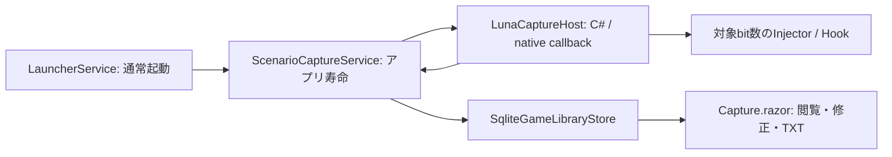

# シナリオ抽出

Windowsのゲーム本文をHOOKで取得し、キャラ名とセリフを組にして保存し、外部分析用のTXTへ出力する。翻訳・アプリ内分析は行わない。取得・分類・話者照合はベストエフォートであり、全作品対応や完全取得を保証しない。

## 利用範囲

- ゲーム編集の「シナリオ抽出」は初期値ON。変更は次回起動から反映する。OFFでは注入・本体選択・新規取得・取得画面への自動切替をしない。既存の起動前セーブリンク準備・Git同期と保存済み履歴は維持する。
- 登録EXEを通常どおり起動する。起動用と本体が異なる場合を含め、初回は実行中の本体を選ぶ。次回は記憶した実行ファイルの絶対パスと一意に一致するプロセスだけへ接続する。未一致・複数一致は手動選択する。PIDは次回用設定にしない。
- 自動検出されたHOOK候補の実出力を見て、「本文」「キャラ名」「取得しない」をゲーム別に設定する。コード・名称・context下位16bitを次回照合に使う。未一致・現在判明している複数候補との曖昧一致は自動選択せず、その回の候補を選び直す。
- 同時取得は1ゲーム・選択した本体1プロセス。OCR、任意HOOKコード、詳細codec/flush設定UI、自動再接続、本体交代追従は扱わない。内部codec・エンジン検出群はLunaHookを利用する。

## 構成



LunaのPythonアプリ・UI・翻訳DBは組み込まない。上流ソースは`library/LunaTranslator`の固定commitをsubmodule参照し、既存CMakeでHost・Hook・font loaderを構築する。GameLauncher側の小さなInjectorは上流`dllinject.cpp`をコンパイルし、翻訳・音声を含むLunaSubprocess全体は同梱しない。取得ページは受信処理の所有者ではない。

## 受信と寿命

`ScenarioCaptureService`をsingletonとし、delegate・ホスト・本体handle・プレイ回・受信順・候補保持・保存待ちを所有する。一覧への移動、通常の×によるトレイ常駐、ページ破棄で取得を止めない。

callback内で文字列と取得元をmanaged値へコピーし、プレイ回内の連番・受信時刻を付ける。DB・UIをcallback内で待たない。候補変更と受信は同じlockで順序付け、保存待ちにはその受信時点のルールを渡す。本文をログへ複製しない。

未選択を含む一時保持は直近30秒・1候補200受信・全体1000受信・UTF-16本文合計2 MiBが上限。超過分は古い順に破棄する。候補表示は最大256候補、各プレビューは1500文字まで。プレビューを保存原文としない。選択時は残る未処理イベントだけを元の連番で保存へ渡す。解除で過去履歴は消さず、再選択で同じイベントを再保存しない。

保存待ちも1000受信・2 MiBを上限とし、超過・単独巨大受信・書込み失敗は未保存としてログに残して諦める。失敗分の再投入・再試行・永続queue・退避ファイル・クラッシュ復旧は行わない。`(SessionId, ReceiveSequence)`で同じイベントだけを二重保存から守り、同文の別callbackを削除しない。ホスト前段の変換・buffering・エンジンfilterにより、ゲーム内の全出現・反復が届く保証はない。

本体終了・切断では新規受付を閉じ、通常の受付済み処理を終えてプレイ回の終了時刻を記録する。トレイの明示終了では最大3秒待って抽出を停止し、ゲームは終了しない。末尾の完全回収や終了時の救済確認は行わない。異常終了で終了時刻がNULLなら「終了未記録」と表示し、成功補完や自動再開はしない。注入・接続失敗はその回を終了し、起動済みゲームの成功を失敗へ変えない。

## 原文と分類

原文は選択済み候補から届いたcallback文字列であり、不変。本文は同じ原文内の`StartUtf16 / LengthUtf16`範囲で表し、先頭から末尾まで空白・改行・括弧を含めて欠けなく覆う。別callbackを自動結合しない。

ゲーム別ルールで、対応する外側の`「…」`をセリフに分け、その外を地の文または未判定にする。内側の引用は残す。閉じていない括弧は未判定、`『…』`単独はセリフと決め付けない。分割OFFは全文1範囲の未判定。候補に既定ラベルを指定した場合は分割後の各範囲へ優先適用する。

ラベルはゲーム別のID参照で、名称と用途種別（セリフ・地の文・その他）を持つ。改名で用途を変えない。ラベルNULLが未判定であり、話者NULLの未確定とは別の状態である。

話者文字列は本文itemと組にして保持し、地の文の有効話者はなしとする。人物マスタは作らない。自動照合は同じ回・対象プロセスの選択済み名前受信と本文だけを使う。

- 受信時刻の前後1秒以内で、単独名1件とセリフ1件が互いに一意の場合だけ照合する。本文から2秒待ち、名前の将来側の窓も閉じてから自動値を更新する。本文は先に未確定で保存する。
- 単独名は任意の「名前の照合一覧」へのtrim後全文一致で判断する。一覧が空・一致しない場合も取得を始められるが、自動話者は未確定のまま。連結名を字数で分解しない。
- 窓内の複数名・複数セリフ・同一原文内の複数セリフは順番に配らず未確定にする。直前名を次の全発言へ持ち越さない。名前の先着・後着とも元の受信時刻で照合し、本文順を動かさない。
- 名前用原文は照合用に保存するが、通常本文/TXTへ独立行として出さない。誤照合・未確定は本文itemの話者を手動修正できる。

通常照合は受信時の名前ルールを保持する最大1000件の判定待ち集合だけへ一度行う。上限超過・照合失敗は原文の保存と区別してログへ残し、話者未確定を許容する。終了時に窓が閉じていない分も完全回収しない。最新ルールで既受信分を周期的に再分類しない。

## 修正と再適用

手動ラベル・話者は値と上書きフラグを分ける。手動NULLは意図した未判定・未確定であり、自動値で埋めない。表示・TXTは手動値を優先する。有効ラベルが地の文なら話者を表示しないが、保存済み手動値自体は削除しない。

ルール保存は以降の受信へ適用する。過去分は利用者が選択したitem ID集合へ明示再適用し、新着を対象へ増やさない。選択範囲の自動ラベル・話者だけを更新する。原文全範囲が選択され、手動修正がない時だけ再分割できる。手動境界・ラベル・話者を含む原文は既存分割を保ち、その範囲内の自動値だけを再判定する。

「原文・分割」では1原文内の境界追加・隣接境界解除を行い、置換後の各範囲のラベル・話者を指定して一つのtransactionで保存する。原文文字列は変更しない。UTF-16位置を使い、サロゲート・結合文字等のtext element途中を手動境界にしない。利用者自身による再修正は可能。別原文をまたぐ結合・全版履歴・人物付替え機能は設けない。

## 保存と登録削除

既存`game-library.db`のschema初期化へ以下を追加する。既存テーブル・適用済み移行・ゲーム/セーブリンク/同期履歴を再作成しない。通常の主キーとFKを使い、独自の整合性台帳は作らない。

| テーブル | 責務 |
| --- | --- |
| CaptureGames | 登録から独立した履歴所有者、表示タイトル、次回ON/OFF、本体絶対パス、候補・分類ルールJSON |
| CaptureSessions | 所有者とプレイ回の開始/終了時刻 |
| CaptureSources | プレイ回内の取得元、PID・HOOKコード/名・64bit値の16進文字列 |
| CaptureEvents | プレイ回と受信連番の複合主キー、取得元・時刻・入力役割・原文・手動境界フラグ |
| CaptureLabels | 所有者別の名称と用途種別 |
| CaptureItems | 原文内UTF-16範囲、自動ラベル/話者、手動上書きフラグと値 |

原文追加と本文範囲作成は同じtransactionでcommitし、それ以前を保存済みとしない。同一プレイ回の取得元・原文・itemは複合FKで結び、書込み境界で同一所有者のラベルと範囲を検証する。

全接続でSQLite FKを有効にする。`CaptureGames.CurrentGameId`は`Games.Id`へのnullable unique FKで`ON DELETE SET NULL`。登録削除では所有者・履歴を残し、表示タイトルで閲覧・出力できる。登録中のタイトル変更は履歴所有者へ反映する。同じslug・タイトル・EXEで再登録しても、新規所有者を作り旧履歴と統合しない。手動付替え・履歴削除・ラベル削除/統合は提供しない。

抽出履歴専用の自動バックアップ・Git同期は追加しない。既存の同期対象へDBを勝手に追加しない。

## UIとTXT

Homeの「抽出・履歴」から`/capture`を開く。ON起動後も同じ画面へ移る。ゲーム編集のON/OFFは同じ画面の保存で確定し、キャンセルでは反映しない。主領域は本文と話者で、候補・分類・ラベルは「抽出設定」ダイアログで扱う。候補は実出力の短文で区別し、全文・診断のコードやcontextは設定内で確認する。受信件数・commit済み件数・破棄件数を区別し、破棄件数には未選択候補の保持期限切れ等を含むことを示す。

取得中は末尾追従時だけ新着を表示し、描画後に末尾へ移動する。過去へのスクロール・範囲選択・編集で追従を止め、明示操作で戻す。選択中は追従を再開せず、解除後に戻す。履歴はゲーム（登録なしを含む）・プレイ回・ラベル（未判定を含む）で絞り、200件単位で読む。ページ切替は本文領域の先頭から表示する。明示した一括操作は表示選択集合にだけ作用する。選択数と操作領域の大きさは変えず、一括修正・設定はoverlay、成功・エラーは固定位置の通知で示し、本文を押し動かさない。ダイアログはkeyboard focusを閉じ込め、Escapeで閉じ、操作元へ戻す。

TXT出力は表示ページの200件制限ではなく、選択したプレイ回のラベル条件に合う全itemを対象とする。UTF-8（BOMなし）、受信連番・原文内開始位置順、項目間は空行。現在のラベル名と有効話者を使う。

```text
[セリフ：美咲]
「おはよう」

[地の文]
窓から光が差した。

[セリフ：話者未確定]
「また明日」

[未判定]
まだ分類していない文章。
```

本文中の括弧・改行を残し、時刻・PID・HOOK診断情報は通常TXTへ載せない。出力は原文や分類を変更せず、同文を重複排除しない。指定フォルダへ新規ファイルを作り、既存ファイルを上書きしない。出力失敗は成功通知にしない。

## ネイティブbuild・安全境界

build手順は[README](../../README.md#windows-での-ui-確認)、依存版と配布条件は[Third-party notices](../../THIRD-PARTY-NOTICES.md)を参照する。Hostはランチャー、Injector/Hookは対象のbit数に合わせる。callbackはcdecl、`ThreadParam`はDWORDと3つのuint64値、boolは1byte。文字列はcallback中にコピーする。Hostはbackground threadを持つためアプリ寿命中にDLLをunloadしない。

接続用pipe、注入要否確認、helper実行、接続callbackを分ける。helper終了だけでは成功としない。接続待ちは15秒で打ち切り、再接続や自動昇格をしない。

上流の32bit注入には、対象に`GuruGuruSMF4.dll`がloadされるか実行フォルダに存在する狭い条件で、そのプロセス内の`WinVerifyTrust`を書き換える処理がある。対象内の他の署名検証にも影響し得るため、信頼できるゲームだけに利用する。この条件を広げず、OS全体の保護解除は行わない。

## 検証境界

自動testは原文・順序・同文別受信、分類/話者、手動値と範囲、登録削除/再登録、OFFと候補保持を一時DBで確認する。UIは実データを持たない隔離環境で実描画と操作を確認する。実ユーザープロファイルのアプリ起動は登録repositoryの監視・同期を伴うため、検証目的で安易に起動しない。

synthetic processでのC#接続確認と、実ゲーム本文の画面照合・全作品対応は異なる。実ゲームの精度、長時間負荷、MSIX配布の成立はそれぞれ対象環境と条件を定めて確認し、build成功だけで確認済みとしない。
