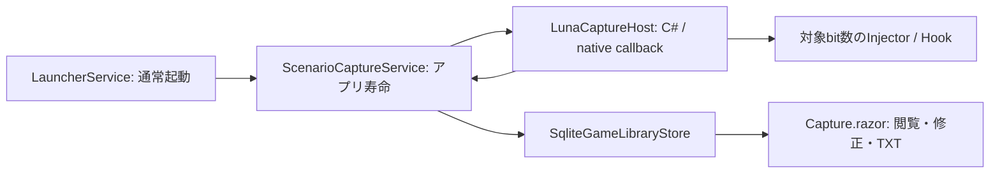

# シナリオ抽出

Windowsのゲーム本文をHOOKで取得し、キャラ名とセリフを組にして保存し、外部分析用のTXT・画像付きZIPへ出力する。翻訳・AIによる内容分析は行わない。取得・分類・話者照合はベストエフォートであり、全作品対応や完全取得を保証しない。

## 利用範囲

- ゲーム編集の「シナリオ抽出」は初期値ON。変更は次回起動から反映する。OFFでは注入・本体選択・新規取得・取得画面への自動切替をしない。既存の起動前セーブリンク準備・Git同期と保存済み履歴は維持する。
- 登録EXEを通常どおり起動する。初回は実行中の本体を選ぶ。次回、登録EXEが記憶済みの本体と同じなら今回起動したプロセスを識別して使う。起動用EXEが別なら、起動後に現れた絶対パス一致の本体が一つで、他の登録と競合しないときだけ引き継ぐ。起動用プロセスの終了後は最大15秒待つ。本体を確定できない場合はPCで手動選択する。PIDは次回用設定にしない。
- 自動検出されたHOOK候補の実出力を見て、「名前」「セリフ」「地の文」「本文（自動判定）」「取得しない」をゲーム別に設定する。本文の固定分類はセリフ・地の文で、未判別は未判定。名前は話者情報であり独立した本文分類ではない。コード・名称・context下位16bitを次回照合に使う。未一致・現在判明している複数候補との曖昧一致は自動選択せず、その回の候補を選び直す。
- 同時取得は1ゲーム・選択した本体1プロセス。OCR、任意HOOKコード、詳細codec/flush設定UI、通常の切断後の自動再接続や本体終了後の別プロセスへの乗り換えは扱わない。内部codec・エンジン検出群はLunaHookを利用する。

## 構成



LunaのPythonアプリ・UI・翻訳DBは組み込まない。上流ソースは`library/LunaTranslator`の固定commitをsubmodule参照し、既存CMakeでHost・Hook・font loaderを構築する。GameLauncher側の小さなInjectorは上流`dllinject.cpp`をコンパイルし、翻訳・音声を含むLunaSubprocess全体は同梱しない。取得ページは受信処理の所有者ではない。

## 接続と受信確認

抽出設定は利用可能な画面に合わせた広い枠を使い、「接続」「取得元」「判定」を切り替える。ヘッダー・下端の確定/適用操作は本文のスクロール外に置き、候補の出現や設定切替で枠・操作位置を変えない。

接続画面の「画面から選択」は3秒後に前面にあるウィンドウの所有プロセスを選ぶ。利用者がゲームを前面にし、戻って対象を確認する。ランチャー自身は対象にせず、カウントダウンの中止・再試行を可能にする。実行中プロセスのメインウィンドウ一覧から選ぶか全プロセスへ切り替え、ウィンドウ名・プロセス名・PID・実行ファイルパスでも部分一致検索できる。画面選択は候補の指定だけで、テスト接続・注入は別の明示操作とし、ゲームの前面化やクリックを自動実行しない。

手動選択はテスト接続から開始する。ゲームを進めて受信した候補の文章を見て用途を指定し、「確定して記録」で本体パスと候補設定を保存する。テスト受信は比較と判定プレビューにだけ使い、履歴・原文・TXTへ保存せず、確定時の遡及取り込みも行わない。確定・切替・終了でテスト本文を破棄し、取得回と正式な受信連番は確定時から開始する。本文用途がない状態では確定しない。次回起動時に本体を特定でき、本文設定もあれば自動で記録を開始する。起動時に候補が間に合わなかった場合も、同じ本体を特定できた後は記録 Web から開始できる。

取得元は最大256候補、各候補の直近5受信をメモリ内に保持し、各受信は先頭1500文字まで表示する。比較一覧には直近3受信を示し、出現順を保って更新候補を強調する。文章の部分一致検索は保持中の5受信を対象とし、同じ文字列でも異なる取得元を統合しない。表示の一時停止中も受信は続け、再開時に最新へ戻る。用途の変更や詳細表示で他の操作を押し動かさない。名前の取得元を指定すれば、その受信内容を話者候補として使い、キャラクター名の事前登録は不要とする。

「判定」は保持中のテスト受信へ現在の分割・用途ルールを適用し、本文・分類・話者の仕上がりを表示する。正式保存と同じ分割・話者照合処理と元の受信時刻を使い、話者の2秒待ち・曖昧時の未確定も共通とする。ルール変更はテストの仕上がりへ反映し、確定前はDBへ保存しない。保持範囲外の受信は対象外で、1500文字を超えて省略した受信も判定プレビューから除き、画面に明示する。正式保存時の原文はこの表示上限で切り詰めない。

プロセスは接続後も選び直せる。記録中の切替は受付済み本文を処理して取得回を終了し、新しい対象をテスト状態にする。既存の本文・区間・確定済み設定を消さず、新しい紐付けは確定まで保存しない。接続失敗・本体終了・切断後も手動で再試行できる。自動再接続は行わない。取得元の選択は未接続・受信待ちを区別し、候補がある時だけ有効にする。

## 受信と寿命

`ScenarioCaptureService`をsingletonとし、delegate・ホスト・本体handle・取得回・受信順・候補保持・保存待ち・指定中の区間開始位置を所有する。一覧への移動、通常の×によるトレイ常駐、ページ破棄で取得を止めない。

callback内で文字列と取得元をmanaged値へコピーし、取得回内の連番・受信時刻を付ける。DB・UIをcallback内で待たない。候補変更と受信は同じlockで順序付け、保存待ちにはその受信時点のルールを渡す。本文をログへ複製しない。

正式記録中の未選択を含む一時保持は直近30秒・1候補200受信・全体1000受信・UTF-16本文合計2 MiBが上限。超過分は古い順に破棄する。候補表示は最大256候補、各プレビューは1500文字まで。プレビューを保存原文としない。記録開始後の候補変更では残る未処理イベントだけを元の連番で保存へ渡す。テスト受信はこの保存用bufferへ入れない。解除で過去履歴は消さず、再選択で同じイベントを再保存しない。

保存待ちも1000受信・2 MiBを上限とし、超過・単独巨大受信・書込み失敗は未保存としてログに残して諦める。失敗分の再投入・再試行・永続queue・退避ファイル・クラッシュ復旧は行わない。`(SessionId, ReceiveSequence)`で同じイベントだけを二重保存から守り、同文の別callbackを削除しない。ホスト前段の変換・buffering・エンジンfilterにより、ゲーム内の全出現・反復が届く保証はない。

本体終了・切断では新規受付を閉じ、通常の受付済み処理を終えて取得回の終了時刻を記録する。トレイの明示終了では最大3秒待って抽出を停止し、ゲームは終了しない。末尾の完全回収や終了時の救済確認は行わない。異常終了による終了時刻NULLは補完せず、自動再開もしない。注入・接続失敗は明示して手動選択へ戻し、起動済みゲームの成功を失敗へ変えない。

正式記録の一時停止は次回起動の抽出ON/OFF、取得元一覧の表示停止とは別の状態で、設定へ保存しない。受信と同じlockで切り替え、停止中は本文・名前を候補・受信buffer・保存queueへ入れず、撮影対象も無効にする。停止中のルール変更や再開で停止中の受信を遡及保存しない。停止前に受付済みの保存・撮影は固定した元の原文へ完了する。同じ取得回の撮影窓の手動選択は保ち、再開後の新しい非空本文が来るまでは新規撮影を拒否する。再開後の最初の保存成功本文は新経路の始点になる。

## 記録の対象とブランチ

抽出設定、対象プロセスの設定、分類・タグの定義、保存済みの名前候補は作品で共有する。記録は作品・対象リポジトリ・現在の論理ブランチごとに分離する。取得回、原文・訂正・個別の話者割当、画像・区間・照合・経路・場面、および区間や場面へのタグ付けは記録側に属する。対象リポジトリは作品の関連リポジトリ設定から解決し、HEAD のコミットではなくブランチを識別する。通常のコミットで記録を分割しない。

未使用の枝の記録は空から始まり、同じ枝に戻るとその記録を使う。枝の出典を持たない既存の記録は「従来の記録」として PC から参照できる。本文や PNG を推定した枝に移したり、複製したりしない。関連リポジトリ未設定では従来通り作品の記録を使う。設定済みでも HEAD が解決できないときは、その間の記録を別の枝や従来の記録へ保存しない。

取得中の記録・画像・保留操作は表示時または受信時の記録対象と取得回に固定する。作品・枝・取得回が変わったら表示と保留操作を切り替え、古い操作を新しい対象へやり直さない。同じ枝へ戻った場合も、切替前の保留操作を復活させない。PC の履歴は既定で現在の枝に追従し、記録済みの枝や「従来の記録」は明示的に選んで表示を固定できる。検索、TXT・ZIP 出力および経路画面は、一度に一つの記録範囲を使う。DB と画像を Git に追加せず、既存の同期設定は変更しない。

## 記録範囲の本文と任意区間

閲覧・出力の主単位は記録範囲。複数起動の本文を取得回ID、回内受信連番、原文内開始位置の順に読む。受信時刻の変更で順序を入れ替えない。取得回はソース識別・連番リセット・話者照合の内部境界として残し、既存の原文と手動修正を移し替えたり複製したりしない。

必要な時だけ自由な名前の区間を保存する。区間は同じゲームの原文位置を示す開始と終了を持ち、開始を含み終了を含まない。区間0件、範囲外の本文、重なり、同名を許可する。全本文の割当や次区間からの自動終点は設けない。名前はtrim後の空欄・改行を拒否するが、章番号などの形式や一意性は要求しない。

境界は`SessionId / ReceiveSequence / UTF-16 offset`で保存する。原文の有効なtext element境界を検証し、開始より後の終了と1件以上の本文が必要。同じ原文の再分割でitem IDが変わっても区間を保持し、現在のitemを境界で切り取って表示・出力する。別の記録範囲や未保存の本文は参照させない。

- **本文で指定**：本文行の「ここから」「ここまで」で先頭行の開始・末尾行の終了を選ぶ。ページをまたいで指定でき、同じ行だけの区間も作れる。名前入力後に保存する。
- **プレイ中に指定**：「区間を開始」は直前に保存queueへ受理した本文の末尾を記録する。取得開始時は未受信でもその取得回の先頭を使える。一時停止から再開した直後は、新しい非空本文を受信するまで開始できない。「末尾を固定」でその時点の末尾を確定し、名前を入力して「区間を保存」する。固定後の受信は含めない。保存前にwriterをflushし、保存済み原文を検証する。空区間や保存失敗を保存成功へ置き換えない。

開始・終了は抽出ON/OFFではない。取消や区間外でも本文は保存する。開始位置はページ移動やトレイ常駐で保持するが、ゲーム終了・切断・アプリ終了では未完了区間を保存せず、自動確定・再起動復元もしない。native bufferingにより押下とゲーム画面の境界は完全一致を保証せず、受理済みログ基準とする。ゲーム内現在位置の取得・ゲームのセーブ/復元は提供しない。保存履歴の「履歴管理」で区間を改名できる。区間削除は名前と範囲の定義だけを削除し、本文を保持する。

## 区間タグと出力条件

区間名と別に、自由な名前のタグを任意で複数付けられる。区間作成時と履歴管理で追加・解除でき、区間名とタグは同じtransactionで保存する。タグ名はtrim後の非空・改行なしの単一行とし、表記を自動統合せず完全一致で区別する。同じ区間の同じタグは一つだけ保持する。既存区間はタグなしで利用できる。

区間と場面は同じゲーム単位の作品タグを共有する。既存の区間タグ名は作品タグへ正規化し、区間・場面の両方から同じタグIDを参照する。改名は各記録範囲のタグ付け先を変えない。他の記録範囲に割当があるタグは、現在の記録範囲から定義ごと削除できない。場面タグは明示的に保存されたものだけを使い、記録済みの話者を自動登録・付与しない。タグは本文の分類・話者・原文を変更しない。

TXT・画像付きZIPの出力操作では、現在のゲーム・区間・分類・適用済みの名前/本文検索に加え、包含タグと除外タグを選ぶ。各欄の複数タグはいずれかに一致する区間を対象とする。包含タグ指定時はその区間の和集合だけを出し、未指定時はゲーム全体または選択中の区間を対象とする。その後、除外タグの区間の和集合を差し引く。重なる部分は除外を優先し、包含区間同士の重複で本文を二重出力しない。タグ未指定は従来の条件と同じで、条件に一致する本文がない出力も許可する。

区間の原文位置で本文を切り取り、除外で分かれる場合は残った複数範囲を受信順・原文内位置順に出す。本文検索は切取後の各範囲へ適用し、除外文字列だけに一致する範囲を出さない。TXTとZIPは同じ出力読出しを使い、表示ページの件数上限には限定しない。ZIPには残った本文の原文に関連する画像だけを含める。画像は原文単位の関連なので、同じ原文の一部を除いた場合も画像自体は切り取らない。

## 原文と分類

原文は選択済み候補から届いたcallback文字列であり、不変。本文は同じ原文内の`StartUtf16 / LengthUtf16`範囲で表し、先頭から末尾まで空白・改行・括弧を含めて欠けなく覆う。別callbackを自動結合しない。

ゲーム別ルールで、対応する外側の`「…」`をセリフに分け、その外を地の文または未判定にする。内側の引用は残す。閉じていない括弧は未判定、`『…』`単独はセリフと決め付けない。分割OFFは全文1範囲の未判定。候補に既定ラベルを指定した場合は分割後の各範囲へ優先適用する。

新規の分類指定はセリフ・地の文の固定選択で、未判定はラベル参照NULLとする。自由追加と名称変更のUI・書込みAPIは提供しない。名前は本文の話者であり、話者NULLの未確定は分類未判定とは別の状態。分類はゲーム別のIDで参照し、保存済みの独自名・用途種別・参照は保持して閲覧・TXTへ出力する。固定分類による絞り込みは同じ用途種別の保存済みデータも含める。

話者文字列は本文itemと組にして保持し、地の文の有効話者はなしとする。人物マスタは作らない。自動照合は同じ回・対象プロセスの選択済み名前受信と本文だけを使う。

- 受信時刻の前後1秒以内で、単独名1件とセリフ1件が互いに一意の場合だけ照合する。本文から2秒待ち、名前の将来側の窓も閉じてから自動値を更新する。本文は先に未確定で保存する。
- 名前用途の受信をtrimし、空でなく改行（CR/LF）を含まない単一行を話者候補にする。登録済みの名前との照合は行わない。区切りのない単一行へ連結された複数名は識別・分解できず、受信した文字列全体が候補となる。
- 窓内の複数名・複数セリフ・同一原文内の複数セリフは順番に配らず未確定にする。直前名を次の全発言へ持ち越さない。名前の先着・後着とも元の受信時刻で照合し、本文順を動かさない。
- 名前用原文は照合用に保存するが、通常本文/TXTへ独立行として出さない。誤照合・未確定は本文itemの話者を手動修正できる。

通常照合は最大1000件の判定待ち集合だけへ一度行い、保存した受信時の用途を使う。上限超過・照合失敗は原文の保存と区別してログへ残し、話者未確定を許容する。終了時に窓が閉じていない分も完全回収しない。最新ルールで既受信分を周期的に再分類しない。設定に保存済みの名前一覧はデータとして保持するが、話者判定には使わない。

## 修正と再適用

手動ラベル・話者は値と上書きフラグを分ける。手動NULLは意図した未判定・未確定であり、自動値で埋めない。表示・TXTは手動値を優先する。有効ラベルが地の文なら話者を表示しないが、保存済み手動値自体は削除しない。

ルール保存は以降の受信へ適用する。過去分は利用者が選択したitem ID集合へ明示再適用し、新着を対象へ増やさない。選択範囲の自動ラベル・話者だけを更新する。原文全範囲が選択され、手動修正がない時だけ再分割できる。手動境界・ラベル・話者を含む原文は既存分割を保ち、その範囲内の自動値だけを再判定する。

「原文・分割」では1原文内の境界追加・隣接境界解除を行い、置換後の各範囲のラベル・話者を指定して一つのtransactionで保存する。原文文字列は変更しない。UTF-16位置を使い、サロゲート・結合文字等のtext element途中を手動境界にしない。利用者自身による再修正は可能。別原文をまたぐ結合・全版履歴・人物付替え機能は設けない。

## 保存と登録削除

既存`game-library.db`のschema初期化へ以下を追加する。既存テーブル・適用済み移行・ゲーム/セーブリンク/同期履歴を再作成しない。通常の主キーとFKを使い、独自の整合性台帳は作らない。

| テーブル | 責務 |
| --- | --- |
| CaptureGames | 作品の設定と従来の記録を所有する行。枝別記録には設定を複製せず、記録IDだけを割り当てる |
| ScenarioBranchHistory | 枝別の記録IDを、作品の設定ID・リポジトリ識別子・完全なブランチ参照名に対応付ける |
| CaptureSessions | 記録範囲と取得回の開始/終了時刻 |
| CaptureSources | 取得回内の取得元、PID・HOOKコード/名・64bit値の16進文字列 |
| CaptureEvents | 取得回と受信連番の複合主キー、取得元・時刻・入力役割・原文・手動境界フラグ |
| CaptureLabels | 同じ作品の記録範囲で共有する分類の名称と用途種別 |
| CaptureItems | 原文内UTF-16範囲、自動ラベル/話者、手動上書きフラグと値 |
| CaptureRanges | 記録範囲別の自由名と原文上の開始/終了位置 |
| ScenarioGameTags | 作品共通のタグ名。区間・場面から参照し、未使用タグも保持 |
| CaptureRangeTags | 区間と作品タグの関係。区間またはタグ削除とともに関係を削除 |
| ScenarioScenes | 手動場面の記録ID、主ラベル、表示番号、章、配置 |
| ScenarioSceneRanges | 手動場面と既存区間の関係。区間削除後も場面を残して関係だけを外す |
| ScenarioSceneTags | 手動場面と作品共通タグの関係 |
| ScenarioSceneConnections | 利用者が編集する有向の場面接続。端点場面の削除で関係を削除 |

原文追加と本文範囲作成は同じtransactionでcommitし、それ以前を保存済みとしない。同一取得回の取得元・原文・itemは複合FKで結び、書込み境界で同一所有者のラベルと範囲を検証する。

全接続でSQLite FKを有効にする。`CaptureGames.CurrentGameId`は`Games.Id`へのnullable unique FKで`ON DELETE SET NULL`。登録削除では所有者・履歴を残し、表示タイトルで閲覧・出力できる。登録中のタイトル変更は履歴所有者へ反映する。同じslug・タイトル・EXEで再登録しても、新規所有者を作り旧履歴と統合しない。手動付替え・ラベル削除/統合は提供しない。

履歴削除はゲーム登録削除と独立した明示操作とする。保存履歴の本文を選び、削除対象の原文と件数を確認して確定する。削除単位は元の本文受信イベントで、同じ原文から分割された全itemを含む。検索・分類条件から外れた同一原文の本文も確認対象に含め、原文とitemを同じtransactionで削除する。itemだけを非表示にして再適用・再分割で復活させる方式は使わない。別の名前受信や他の本文は残す。区間の原文位置・取得回は維持し、区間内の削除済み本文は表示・TXTから除かれる。削除後に空になった区間も保持する。

「全履歴を消去」は確認画面に示した記録範囲の全取得回・取得元・受信原文（名前を含む）・本文・区間を一つのtransactionで削除する。その範囲内では検索や表示区間に限定しないが、従来の記録を含む他の記録範囲には適用しない。抽出ON/OFF、本体パス、取得元の用途・分類ルール、共通定義、ゲーム登録、セーブデータは維持する。対象作品の取得中は削除を確定できず、先に「取得を停止」で保存待ちを処理して終了する。ゲームのプロセスは終了しない。操作後も保存済み設定でテスト接続・記録を再開できる。自動削除やundoは提供せず、確認画面で戻せないことを示す。

抽出履歴専用の自動バックアップ・Git同期は追加しない。既存の同期対象へDBを勝手に追加しない。

## 連続本文照合と共通資料

`CaptureEvents`と`CaptureItems`を原記録として保持し、同じ`CaptureGames.Id`の保存済みitemを取得回ID・受信連番・原文内開始位置順で照合する。ゲーム登録、区間・タグ、ゲームエンジンの現在位置取得に依存しない。取得回内のロード後の再訪も扱うが、自身と重なる出現や、別取得回の末尾と先頭をつないだ列を候補にしない。

初期値は3件連続、うち1件以上が10 text element以上の本文で始点を認める。セリフ・地の文の本文と分類（ラベルと種別）を完全一致で検証し、双方で確定した話者が違う場合は不一致とする。正規化・類似一致は使わない。未判定・その他は一致の連続性を切り、原記録と出力には残す。SHA256は本文・分類の3連続から候補を引くためだけに用い、本文をhashだけで同一としない。話者未確定は追加の同一性根拠にせず、既に確定話者を持つ共通グループを経由して異なる確定話者をまとめることも避ける。

短い定型句だけの列や、まだ異なる場面の候補が複数ある列は確定しない。既に照合済みの複数周回はcanonicalな並びで一候補へまとめる。一致を確定したら未確定の前方文脈へ遡り、以後は短文も一件ずつ比較する。差が出る直前で対応区間を閉じ、異なる一件から次の探索を始める。後の3連続で共通パートへ戻れば別の対応区間を作る。

| テーブル | 責務 |
| --- | --- |
| ScenarioMaterialState | 作品ごとの資料版・照合世代、変更失効と処理済み位置 |
| ScenarioSequenceIndex | itemの取得回内連続位置、候補用3連続hash、照合済み代表への対応 |
| ScenarioMatchRanges | 代表側・再訪側それぞれの開始連続位置と一致件数 |
| ScenarioMatchProgress | 取得回ごとの継続中・曖昧候補と探索再開位置 |

本文保存は照合を待たない。アプリのDIでstore寿命のworkerを明示起動し、初回は既存の永続未処理分、以後は保存commit後の追加分を処理する。既定32件（API上限128件）の短transactionとbatch間の待機を使い、本文書込み待ちがあれば照合を延期する。workerの取消・終了は保持Taskをjoinし、未完了transactionはrollback、処理済み位置は次の起動で再開する。既存の本文受信queueや未保存件数の契約は変えない。訂正・再分類・話者更新・再分割・削除は同transactionのtriggerで作品の照合を失効させ、再構築までは古い対応を読取へ使わない。変更がなければ再出力時に過去の全件を再照合しない。本文保存失敗を照合で救済しない。

`IScenarioMaterialReader.GetScenarioProjectionAsync`はUI thread外で資料を準備し、選択条件を先に適用してから共通の`ScenarioMaterialProjection`へ投影する。MCP hostは各HTTP要求の認証から`ScenarioMaterialAccessLevel`を決定し、tool/resource引数から権限を選ばせない。ZIPとMCPは同じprojection DTO・識別子を使い、ZIPは既存connection/transaction内のsnapshotから組み立てる。MCP transportと設定は[シナリオ MCP](scenario-mcp.md)を参照する。

内部の完全snapshotは本文・出現と照合に加え、区間の元境界・選択本文との`spans`・タグ、選択内分類、画像metadata、flowを同じSQLite transactionから読む。`ScenarioMaterialWireAdapter.ToWire(snapshot, level)`がallowlist DTOの`ScenarioStructureProjection`または`ScenarioFullProjection`へ変換し、`ScenarioMaterialProjection`はこの二型だけをJSON polymorphismへ登録する。内部snapshot自体を返却projectionのpropertyとして公開しない。ZIPの`material.json`もMCPの読取と同じprojectionを使う。

- `version`: wire形式の`ScenarioMaterialWireVersion(captureGameId, revision, matchingRevision)`。`captureGameId`は文字列、revisionは数値。本文・有効分類/話者・境界・区間タグ・画像関連・観測経路指定・手動場面/作品タグ/手編集接続の変更は`revision`、照合batchの反映は`matchingRevision`を更新する。手動metadataだけの変更では照合世代・未処理状態を変えない。同じDB snapshotの両世代を揃え、独自の整合性hash台帳は作らない。
- `selectionVersion`: 選択後の順序付き`occurrenceIds`、`rangeIds`、`sceneIds`、`tagIds`。検索語を含めず、同じ資料版に対する選択結果scopeを示す。
- `matchingComplete`: snapshot内の未処理の有無。記録が優先され未完了の場合も原記録を出し、未確認の一致は使わない。
- `contents`: 選択されたitem/部分segment。Structureでは`id/kind`だけ、Fullでは`id/text/kind`を持つ。照合で確認した同じ並びだけが同一contentを参照し、文字列だけで重複排除しない。
- `occurrences`: 原記録順の出現。Structureは`source/contentId/labelId/labelName/receivedAt/images`、Fullはそれらに`speaker`を加えた情報を持つ。ラベル・画像はその出現自身の値で、他周回の値を持ち越さない。
- `matches`, `ranges`, `classifications`, `images`, `graph`, `sceneFlow`: 同じ選択範囲の対応、元区間/タグ/分類、画像寸法/hash、観測経路、手動場面構造を表す。Structureでは本文と個別出現/graphの話者propertyを含めず、区間集約の話者名と件数だけを両権限で共有する。

`source`は`ScenarioMaterialWireReference(captureGameId, sessionId, receiveSequence, startUtf16, lengthUtf16)`で、item IDやZIP内で再採番したIDでなく原文位置を根拠にする。occurrence IDは`occ:<captureGameId>:<sessionId>:<receiveSequence>:<startUtf16>:<lengthUtf16>`、content IDは選択内代表のoccurrence IDに`content:`を付け、match IDはcontent IDに`match:`を付ける。先行要素数で増える`content-N`形式は使わない。flow出現IDもraw spanから同じ関数で作り、node IDは`node:<game>:<blockId>`（内部`/`は`~`）、chart IDは`flow:<game>:<chartId>`とする。64bit整数のIDは不変文化の10進文字列、受信連番・UTF-16位置・長さ・資料世代などの量は数値とする。手動場面・作品タグIDとその参照も保存longの10進文字列で、文字列へprefixを付けない。game IDは所属検証のcontextとして別に照合する。opaque image IDは元の文字列を維持する。これらのIDは同じ作品・Version・SelectionVersionのMCP/ZIP間では同値だが、古い資料版へ新しい結果を無断で付け替えない。部分選択は原文内の半開区間を保ち、元の一致itemの相対開始位置・長さが同じ選択sliceだけでcontentを共有する。

`ScenarioMaterialSelectionVersion`は選択後の安定順`occurrenceIds/rangeIds/sceneIds/tagIds`を持つ構造recordで、検索語や単調counterではなく結果scopeを表す。`SameSelection`は四つの配列をOrdinalの値列で比較し、配列instanceの参照同一性を使わない。異なる条件でも四つのID列が同じなら同scopeで、画像読取では`Version`と併せて照合する。別hash、可逆encoding、ID台帳、永続selection状態は作らない。

たとえばタグなしの3周が共通の冒頭3件を通り、2周目だけ「うん」が「いや」に変わり、共通の後半3件へ戻る場合、共通本文6件と各返答2件をcontentsへ一度ずつ置く。occurrencesのcontent参照を各回の順に辿れば分岐と再合流を復元でき、2周目の返答だけに付いた画像もその出現だけから参照できる。2周目のタグだけを選べば、初出が範囲外でも2周目の本文・話者・画像・位置だけを出す。

Structure projectionはflow構造・接続・出現位置・タグ/範囲/分類・画像一覧metadataと区間集約の話者名/件数を返し、本文・抜粋・個別出現/graphの話者・preview・画像bytes・thumbnail・端末path・本文/話者検索語のpropertyを出さない。機密値をmaskしたりnullへ置換したりせず、property自体を省略する。明示された範囲/タグ/分類名はそのまま扱い、本文や話者から名前やpreviewを生成しない。ローカルUIは適用済み本文/話者検索を選択条件に使えるが、Structure出力は検索語をmanifestへ含めない。MCPのStructure権限では本文/話者検索を無視でなく拒否し、検索結果の有無から内容を推測させない。Full projectionは本文・個別話者も含む。

画像本体は`IScenarioScreenshotStore.ReadScenarioImageAsync(level, request, cancellationToken)`でFull権限だけに返す。要求は作品ID、元selection、wire版、`SelectionVersion`、occurrence ID、image IDからなり、外部projectionの版をそのまま渡せる。Structureと未定義levelはrequest/game/資料準備より先に拒否する。Fullは画像gate内の同一transactionで元selectionを再投影し、`ScenarioMaterialImageAccess.Validate(currentSnapshot, level, request)`で全Version・scopeの値列・選択内出現とimage IDのexact関連を検証してからbytesを読む。graph内のcutで分割された出現IDはraw spanが選択本文内に含まれ、その原文に画像が関連する場合だけ解決する。共通contentだけを根拠に別出現の画像を付け替えず、file pathは返さない。これはAPI認可であり、同一ユーザーのfile/shell/SSHアクセスを隔離するものではない。

Full/Structureのどちらも区間・タグ・分類・検索条件を先に適用し、選択内だけをprojectionする。絞込み後に間が空いた場合は元のitem位置と隣接情報を使ってread-time cutを置き、選択外の本文、話者、画像、原代表イベント参照を出さず、実際には観測されていない接続を追加しない。このcutはDBへ保存せず、raw `ScenarioFlowOverrides`や既存境界を変更しない。手動場面も同じ選択済み区間・出現との交差から投影し、端点が残らない手編集接続は出さない。

### 区間話者集計

共通projectionの`ranges[]`は`speakerCounts: [{ speakerName: string, dialogueCount: number }]`と`unknownSpeakerDialogueCount: number`を持つ。ZIPでは両modeの`material.json.ranges`、MCPでは同じ共通rangeから取得する。`manifest.ranges`は位置・タグ・spanの索引として維持し、集計を重複格納しない。本文や画像を開かずに、選択された区間の登場話者とセリフ数を確認できる。

集計対象は全選択条件適用後のsliceと区間の半開範囲が実際に交差する、現在の有効分類が`Dialogue`の記録済み`CaptureItems`だけとする。文字数・句読点数・callback数・canonical content数ではない。一つの元itemが包含/除外による複数clipで同一区間に交差しても、`CaptureItems.Id`ごとに1件。同じ原文内の分類分割は別item、同文の別出現や別周回も別itemなのでそれぞれ数える。区間ごとの集計は独立し、区間間を合算して重複排除しない。分類/境界修正後は現在のitemから再導出する。永続統計・別キャッシュ・人物マスタは作らない。

`Narration`・未判定（`null`）・`Other`は除外し、話者があっても`Dialogue`と推測しない。Dialogueの有効話者がnull/空白の場合は`unknownSpeakerDialogueCount`へ数え、名前を補完しない。確定名は有効話者文字列のOrdinal完全一致でまとめ、Ordinal名順で返す。表記揺れ・大小文字・別名を自動名寄せしない。`dialogueCount`は正数、確定話者がなければ`speakerCounts`は空配列、未確定Dialogueがなければ`unknownSpeakerDialogueCount`は0。非Dialogueだけ/空区間の0件と、絞込みで区間自体が対象外になった配列要素不在を区別する。0件は完全取得や分類確定を保証しない。

同じVersion/SelectionVersionのStructureとFullは同じ区間集計を返す。公開例（既存位置・タグ・spansは省略）:

```json
{"id":"9007199254740993","speakerCounts":[{"speakerName":"美咲","dialogueCount":3}],"unknownSpeakerDialogueCount":1}
```

Structureで追加公開するのはこの区間集約名と件数だけ。個別`occurrences[].speaker`と`graph.occurrences[].speaker`、本文・抜粋・画像本体はFull限定のまま、StructureKeyでの本文/話者検索も許可しない。集計名を作品タグへ自動登録しない。

## 経路図と出現ごとの区切り

フローチャートはゲーム全体の共通readerを元順序で読み、確認済み`matches.items`のraw位置対応だけを使って共通blockへまとめる。未タグ・手動区間未設定・既存履歴も対象で、1件または辺0件の記録もchartへ所属させる。本文が同じだけの未確認出現は別blockとする。辺は実際に観測した隣接出現の対と取得回を保持し、手動区間の重なり・同名を時系列接続と解釈しない。各blockの取得回・出現順を選び、その回の本文・画像へ戻れる。取得中は更新アイコンで読み直す。本文一覧の区間・分類・検索はgraphへ適用せず、表示中は一覧専用の絞込み・編集と分ける。

取得中の経路区切りは、記録を続けたまま次の本文の直前だけを切る。一時停止からの再開も同じ新経路を作る。受付epochを保存queueへ渡し、writerは最後に保存成功した非空本文のepochを追う。名前・空本文・同じ受信の再投入（`inserted=false`）では区切りを消費せず、新経路の最初の本文とcutを同じtransactionで保存する。履歴本文またはgraphの「ここから別経路」は、選んだ出現のincoming traversalだけを除き、他周回の同じ辺やその出現からの後続辺は残す。原文・画像・同周回の再訪は削除しない。

`ScenarioFlowCuts`は取得回・受信連番・UTF-16 offsetによる出現直前のcutを、`ScenarioFlowRegions`は独立所属のraw開始/終了位置を保存する。可変のitem IDや手動区間を所属の正本にせず、同じcutの追加は冪等とする。独立範囲は確認後に別block scopeへ分け、本編との自動接続を外す。前後の本編を飛び越して直結せず、範囲内本文を全削除した後も境界越えの架空の辺を作らない。既存の独立範囲との重なりは拒否する。確認済み共通対応へ分割点を伝播させ、同じ原記録位置の訂正・再分割と両立させる。cut/所属の更新は同transactionの資料版更新helperを呼ぶ。全履歴消去では取得回の削除に伴いcut/独立所属も消え、原記録の個別削除では保存した境界を維持する。

## 手動場面フロー

`sceneFlow`は手動で保存した場面構造で、`graph`が表す観測済みの本文出現と遷移とは別の情報である。手動接続を記録上の遷移として扱ったり、観測graphのread-time cutを手動接続へ補間したりしない。手動場面は作成時の機械IDを保ち、主ラベル・表示用番号・任意の章見出し・X/Y配置、既存区間ID、明示した作品タグIDを持つ。表示番号は識別子ではなく一意である必要もない。有向の手編集接続は分岐・合流を表せる。

場面は本文・raw span・画像linkを複製しない。既存`CaptureRanges`を場面へ関連付け、画像はその範囲内で選択された既存出現と`CaptureEventImages`の関係から導出する。作品共通の`ScenarioGameTags`は`CaptureRangeTags`と場面の双方から参照される。話者候補は自動的にtag masterへ登録せず、明示保存されたタグだけを場面・区間へ関連付ける。

全域選択では、区間に関連付いていない独立場面と、どの場面・区間にも未使用の明示tag masterも含め、保存済み場面・タグ構造を返す。有効な絞込みがある場合は、区間の選択済み本文との交差から場面を絞り、場面の`rangeIds`は交差した区間に限定する。選択区間の`rangeTags`と、それらの区間または残った場面から参照されるタグだけを返す。手編集接続は両端の場面が残る場合だけ返し、選択外の欠落を飛び越える接続は生成しない。包含/除外タグ条件は従来どおり区間タグを対象とし、場面タグ検索へ拡張しない。空白だけの本文検索や空タグ配列は絞込みにしない。

`ScenarioStructureProjection`と`ScenarioFullProjection`は同じ`sceneFlow` metadata DTOを持つ。`tags`、`rangeTags`、`scenes`、`connections`の各IDと参照は保存longのprefixなし10進文字列とし、作品所属は別途検証する。`sceneIds`と`tagIds`は`SelectionVersion`へ選択結果の順序付き値列として含めるため、両権限・MCP・ZIPで同一資料版と四つのscope列を照合できる。Structureにも手動入力のタイトル、表示番号、章、座標、タグ/区間参照、手編集接続を出せるが、本文・抜粋・画像bytes・画像pathは含めない。画像本体は既存のFull専用出現画像gateからのみ取得し、場面専用の画像保存/APIは設けない。

手動場面・作品タグ・手編集接続の実変更は同じtransactionで資料`Revision`だけを進め、本文照合の`MatchingRevision`、Dirty状態、処理済みcursorは変更しない。区間タグは既存の資料版更新経路で管理し、同じ変更に新たな重複更新を加えない。表示名・番号・配置を変更しても機械IDは変えない。場面またはタグの削除ではその関連だけを解消し、場面削除で元区間・本文・画像を削除しない。区間削除や全履歴消去では該当する場面-区間リンクだけを外し、手動場面・手編集接続・作品タグmasterを保持する。本文や画像を別の出現へ付け替えない。

## UIとTXT

Homeの本のアイコンから`/capture`を開く。ON起動後も同じ画面へ移る。ゲーム編集のON/OFFは同じ画面の保存で確定し、キャンセルでは反映しない。本文・話者を主領域とし、操作はアイコンを基本にする。常設の案内文・重複した状態説明は置かず、本文・名前・入力項目・必要な状態とエラーを表示する。アイコンにはtitleとaccessible nameを持たせ、選択状態はaria-pressedで示す。接続・取得元の比較・判定プレビューは抽出設定の各タブで扱い、保存履歴では自動判定ルールだけを編集する。診断のコードやcontextは取得元の詳細を開いて確認する。今回の受信・commit済み件数・未保存/破棄件数は別のアイコンと数値で示す。未保存/破棄には未選択候補の保持期限切れ等を含み、titleとaccessible nameでも区別する。

取得中のゲーム全体表示は末尾追従時だけ新着を表示し、描画後に末尾へ移動する。過去へのスクロール・本文での区間指定・修正で追従を止め、明示操作で戻す。選択中は追従を再開せず、解除後に戻す。履歴はゲーム（登録なしを含む）・区間（ゲーム全体を含む）・分類（未判定を含む）で絞り、200件単位で読む。区間の表示中は修正・選択削除を無効にし、「ゲーム全体」へ戻して元itemを選ぶ。切り取った表示外を無言で変更しない。同名区間は表示上の件目で区別する。

履歴検索は名前と本文を別々に入力し、区間・分類を含むすべての条件を満たす本文を返す（AND）。名前は表示上の有効話者、本文は区間で切り取った表示本文を対象に、OrdinalIgnoreCaseの部分一致でページング前に絞る。名前だけ・本文だけでも検索でき、空欄・空白だけの欄は条件にしない。検索文字はtrimし、`%`・`_`等もワイルドカードではなく文字として扱う。検索ボタンまたはEnterで名前・本文を適用し、区間・分類の変更とページ送りでも適用済み検索を保持する。検索解除は名前・本文だけを空にし、ゲーム変更時は全条件を解除する。履歴のDB読込・照合と全件出力用の検索はUI threadを塞がないように実行し、読込中を表示して重複操作を抑止する。

プレイ中の区間開始・末尾固定・取消をゲーム状態と同じ領域に置く。通常の本文行には本文と話者を表示し、画像・訂正・分割・一括操作の対象選択は行を開いて行う。本文から区間を指定するときは両端を選ぶ。追従・ページ切替から、一括修正・設定・場面編集・出力は分け、後者は「操作」から開く。ページ切替は本文領域の先頭から表示する。明示した一括操作は表示選択集合だけを取得回ごとに修正する。一括修正・設定・区間名入力はダイアログで行う。操作後も既存のボタン・入力・本文の位置を保ち、不要な成功表示は省き、失敗の詳しい理由と回復方法は明示操作で開く。ダイアログはkeyboard focusを閉じ込め、Escapeで最前面を閉じて操作元へ戻す。

TXT出力は表示ページの200件制限ではなく、選択したゲーム全体または区間の分類・検索条件に合う全itemを対象とする。UTF-8（BOMなし）、取得回・受信連番・原文内開始位置順、項目間は空行。現在のラベル名と有効話者を使う。

```text
[セリフ：美咲]
「おはよう」

[地の文]
窓から光が差した。

[セリフ：話者未確定]
「また明日」

[未判定]
まだ分類していない文章。
```

本文中の括弧・改行を残し、時刻・PID・HOOK診断情報は通常TXTへ載せない。出力は原文や分類を変更せず、同文を重複排除しない。指定フォルダへ新規ファイルを作り、既存ファイルを上書きしない。出力失敗は成功通知にしない。

## 手動スクリーンショットと分析用ZIP

正式記録中はアプリ寿命の`ScenarioScreenshotService`がグローバルキーを登録する。初期値はAlt+Shift+Sで、撮影設定からCtrl/Alt/Shiftと英数字・F1〜F11の組合せを保存できる。ゲームのスキップ操作などと重ならない組合せを使う。ページ移動やトレイ常駐では解除せず、取得終了・切断・アプリ終了で解除する。競合などの登録失敗、撮影中の再入力、対象消失、画像・本文保存失敗は撮影状態に表示する。キーリピートによる連写と待ち行列は設けず、同時処理は1件とする。

キー置換は新登録・設定保存の成功時だけ有効設定を更新する。失敗時は以前の有効な登録へ復旧し、復旧失敗は未登録として再設定を案内する。設定ファイルは同じディレクトリの一時ファイルへ書いてから置換し、書込失敗で以前のファイルを壊さない。失敗と処理中の拒否は既存Windows通知と短音で伝え、同serviceの通知を5秒間抑制する。音や通知の表示はWindowsの設定にも依存する。アプリ起動中の直近失敗は停止の状態更新とは別に保持し、撮影設定から時刻・理由・再設定方法を確認できる。新しい永続通知履歴は設けない。

通常終了は新規撮影を止めて受付済みTaskを待つ。10秒の猶予後は協調中止を要求し、PNG取得・本文flush待ち・画像保存gate/一時書込で中止を受け付ける。DB commit前の中止では関連と作成途中の画像を残さず、commit確定後は保存済みとして返す。終了Taskだけを時間切れにして撮影処理を切り離さない。commit等の確定境界を待つため、厳密に10秒以内にアプリが閉じるという保証ではない。

撮影は最前面ゲームのクライアント領域だけを`GetClientRect`・`ClientToScreen`・desktop DCの`BitBlt`で取得する。タイトルバー・枠は含めず、ゲームへキーを送ったり、撮影後にアプリやプレビューを前面化したりしない。本文取得PIDに対象窓が1件なら自動選択する。複数・不在の場合は明示選択が必要で、無関係な前面窓への代替はしない。撮影窓だけ別プロセスへ変更できるが、本文の取得先や履歴所有者は変更しない。HWND/PIDは現在の取得回だけの値とし、終了や再接続で破棄する。窓の消失・PID不一致・最前面でない場合は撮影しない。

キー受付時、正式記録で最後に保存queueへ受理した非空Bodyの`CaptureGameId / SessionId / ReceiveSequence`を同一lockで固定する。名前受信は対象を進めず、テスト受信・本文未受信・終了処理中は拒否する。撮影・PNG変換・hash計算は本文writerから分離し、受付済み本文をflushした後に原文の存在・所有者を確認して関連を保存する。処理中の新本文・取得回変更で固定した対象を置換しない。保存に失敗した原文へリンクしない。画像は近傍シーンの目印であり、ゲーム表示との厳密な同期や±1行以内の保証はしない。

画像はDBと同じデータrootの`scenario-images`へPNGで保存する。画素は上から下・左から右のpaddingなしRGBA8、alpha=255に正規化し、32bit little-endianの幅・高さを先頭に付けたSHA256を`sha256-dimensions-rgba8-v1`として使う。圧縮済みPNGではなく寸法を含む画素の完全一致だけを共有し、縮小・非可逆圧縮・近似一致は使わない。

`CaptureImages`に画像ID・寸法・pixel hash、`CaptureEventImages`に原文の複合キー・画像ID・撮影時刻を保存する。原文と画像は多対多。同じ原文への同じ画像は追加せず最初の撮影時刻を維持する。関連は再分割で変わるitem IDではなく原文キーに結ぶ。ゲーム登録削除では保持する。原文削除・全履歴消去では本文と関連のDB削除を確定した後、未参照PNGを削除し成功時だけ画像metadataを除く。後片付け失敗でも本文の削除は完了として一覧を更新し、未回収件数・理由・明示再試行を案内する。未参照の`CaptureImages`から対象を導出し、別tableや起動時の自動GCは設けない。未回収PNGは同hashの再撮影で再利用でき、参照された後は回収対象にしない。画像をセーブデータのGit同期へ追加しない。

該当の本文行を開き、その原文に紐づく画像を選ぶ。PCでは表示ページの原文key集合の添付件数を1SQLで取得し、行を開いたときに画像の枚数を示す。0枚と取得失敗を区別し、件数表示のために画像本体を読まない。再分割された同じ原文の行にも同じ添付件数を示す。ZIP出力はTXTと同じ適用済みゲーム・区間・分類・名前・本文AND条件の全件を対象とし、表示ページ上限を適用しない。本文・分類・話者・区間・画像関連を同一DB snapshotで確定し、出力中は対象画像の削除と競合させない。ZIPは新規ファイルへ完成してから公開し、既存出力を上書きしない。欠落画像やコピー失敗を成功扱いしない。

- `manifest.json`: format=`GameLauncherWithGit.scenario`、schemaVersion=3、`contentMode`（`structure`または`full`）、出力時刻、ゲーム、条件snapshot、区間一覧`ranges`、hash方式、画像metadataを持つ。位置はUTF-16 code unitで表す。`identifierScope=archive`はarchive文書内のmanifest参照を表し、共通`material.json`のraw由来IDを別値へ変換する指定ではない。`selection.rangeId`は選択区間のID（全域ならnull）、`selection.labelId`は分類ID（分類指定なしならnull）。ID/referenceはJSON文字列、受信連番・UTF-16位置などの量はJSON numberとする。区間定義の複製は持たず、選択しても一致本文がなければ`ranges`は空になり得る。Structureでは`textSearch`/`speakerSearch`のpropertyを省略し、`images`へpathを含めない。Fullでは`textFile`/`textIndexUnit`と画像pathを記録する。
- `texts.jsonl`（Fullのみ）: 原文イベントごと1行。取得回・受信連番・原文内開始位置順で、選択された現在のsegmentの開始・長さ・本文・有効分類/ラベル/話者と、画像ID・撮影時刻を記載する。除外部分を含む`rawText`は出力しない。同文別イベントを統合しない。
- `material.json`: 同じsnapshot/selectionの共通`ScenarioMaterialProjection`。manifestの`materialFile`から参照し、`materialVersion`と`matchingComplete`もmanifestへ記載する。Structureでは`ScenarioStructureProjection`を直接JSON化し、本文・個別話者・preview・path等のpropertyを持たない。両modeの`ranges[]`には[区間話者集計](#区間話者集計)を含む。Fullでは`ScenarioFullProjection`を出す。共通本文を一度で読む利用側はこちらを読み、従来の出現ごとの本文が必要ならFullの`texts.jsonl`を使う。schema 2で定義した本文・区間・元境界・spans・画像構造を置換しない加算fileで、旧ZIPは変換・上書きしない。

- `images/<id>.png`（Fullのみ）: 選択本文が参照する画像だけを重複なく収録する。IDは出力内識別子、pathは相対pathとし、端末上の絶対pathは載せない。Structureは画像ID・媒体形式・寸法・pixel hashをmetadataとして示すが、pathと画像entryを作らない。部分区間でも画像の関連範囲は`capture_event`、方法は`latest_received_body`と明示し、後続本文へ暗黙に持ち越さない。

二つのmodeとも同じ選択scopeと`ScenarioMaterialProjection`を使い、同一作品・資料版・SelectionVersionならoccurrence/content/match/flow/image IDは一致する。Structure ZIPは本文や抜粋を含むpropertyを追加せず、検索語も保存しない。Full ZIPは既存の本文・画像出力を維持する。`IScenarioScreenshotStore.ExportScenarioArchiveAsync`は`ScenarioMaterialAccessLevel`を受け、`Structure`/`Full`を明示して既存ZIP writerへ渡す。

新規ZIPはschemaVersion=3を使う。schema 2で定義したFullの`texts.jsonl`、`ranges`、元境界、spans、画像metadataと選択動作は維持し、manifestには共通資料への参照を追加する。ID/referenceは文字列で出力する。64bit整数として保持するIDは不変文化の10進文字列とし、opaque ID（例：hex形式の画像ID）およびraw由来の複合ID（occurrence/content/match/flow ID）はそれぞれの共通projectionで定義する文字列表現を維持する。`eventId`は`<sessionId>:<receiveSequence>`、occurrence IDは`occ:<captureGameId>:<sessionId>:<receiveSequence>:<startUtf16>:<lengthUtf16>`、content IDは`content:`と代表occurrence IDの連結、match IDは`match:`とcontent IDの連結である。`contents[].kind`と出力条件の`kind`は`Dialogue` / `Narration` / `Other`の文字列、未判定は`null`にする。revision、matching revision、受信連番、UTF-16位置と長さなどの量はJSON numberのままにする。manifestの`materialVersion`はmaterialの`version`と同じ形・値を持ち、domain snapshotを直接JSON化しない。既存schema 2 ZIPは変更・変換しない。

`ranges`の各要素は文字列`id`、`name`、`start`、`end`、文字列配列`tags`、交差範囲配列`spans`を持つ。保存済み区間の開始位置順（同位置はID順）で、同名・重複・隣接区間は独立したIDのまま保持する。区間metadataを加えてもFullの`texts.jsonl`本文を複製せず、Fullでは区間外の本文も現在の出力条件に従って出す。Structureには本文を出さない。

`start`と`end`は保存された元境界で、`{ sessionId: string, receiveSequence: number, offsetUtf16: number }`。位置は取得回IDの数値順、受信連番順、原文内UTF-16 offset順に比較し、開始を含み終了を含まない。取得回は時刻順やJSON文字列の辞書順で比較しない。`sessionId`はFull JSONLにある同名fieldと一致し、`eventId`は`sessionId:receiveSequence`。StructureではJSONLを出さないが、metadataの参照は同じrawイベント位置を使う。開始/終了イベントが削除済み・選択外の場合や、取得回先頭の`receiveSequence=0, offsetUtf16=0`を境界とする場合もある。元境界は本文の収録を保証せず、出力対象に合わせて移動しない。

`spans`は区間と実際に出力された各segmentとの交差で、`{ eventId: string, startUtf16: number, lengthUtf16: number }`を取得回・受信連番・原文位置順に持つ。Fullでは`texts.jsonl`と同じ順序で、Structureでは選択済みprojectionの出現順に対応する。segmentと同様に原文内の半開区間`[startUtf16, startUtf16 + lengthUtf16)`を表す。各spanは対応eventの一つの選択segment内に収まり、segment本文内の相対位置は`span.startUtf16 - segment.startUtf16`で得る。区間がsegmentの途中で始まる場合も本文を再分割しない。分類分割・除外・検索・削除による穴をspan間へ補完したり、両端間の全文が収録済みと解釈したりしない。タグや分類・有効話者はそれぞれ区間とsegmentの情報であり、一方を他方へ自動付与しない。

区間・タグ・分類・名前・本文の絞込みがないゲーム全体出力は、本文削除で空になったものも含めて全保存区間を収録し、その場合の`spans`は空配列になる。検索の空白だけの値と空のタグ配列は絞込みとしない。それ以外は、すべての出力条件適用後のsegmentと交わる区間だけを収録する。選択区間も例外にせず、無一致時に名前・境界・タグを別経路から出さない。交差する区間の元境界・名前・全タグは出力するが、無関係な区間や除外範囲内だけの区間metadataは出さない。Fullは出力条件の検索語・包含/除外タグ名・`rangeId`を条件snapshotへ記録する。Structureは本文/話者検索語のpropertyを省略し、選択済みIDとVersion/SelectionVersionで結果scopeを示す。

schema 3でも区間定義を`ranges`へ明示し、選択区間の表現を`selection.rangeId`へ統一する。ID/referenceは文字列、量は数値というwire型をZIP全体で保つ。既存ZIPを上書き・変換せず、新しく出すZIPの契約として適用する。ZIPを読む側は`schemaVersion`を確認する。アプリにはZIP再取込・旧schema読出し・互換出力の経路を設けない。

`manifest.screenshotOccurrences`は選択済み出現を持つ原文ごとに一要素を持ち、`eventId`、raw取得回の文字列`sessionId`、数値`receiveSequence`、文字列配列`imageIds`を示す。部分event・複数segmentでも一要素で、選択後の原文だけを含む。空配列は確認済みの添付なし、要素不在は選択projection外であり未添付と決めつけない。同じ画像を複数eventが使う場合は各出現を残し、Fullの実ファイルと両modeの`manifest.images` metadataは画像ごと一つだけにする。FullのJSONL event画像集合および共通material occurrenceの画像参照と一致させ、先行する共通contentの画像を推定で付けない。

Structureの利用側は`material.json`のraw source位置・occurrenceごとのimageIdsとmanifest画像metadataを使い、ZIP内に画像path/PNGがあると仮定しない。Fullの利用側は`sessionId`と`receiveSequence`で`screenshotOccurrences`を引き、得た画像IDのpathをmanifestで解決できる。MCPは同じprojectionを使い、Full画像APIも作品・selection・資料版・SelectionVersion・Occurrence ID・Image IDをgate内で検証してbytesだけを返す。内部`IScenarioScreenshotStore.GetEventScreenshotMetadataAsync(captureGameId, events, cancellationToken)`も同じevent粒度で、要求順のID・撮影時刻と添付0件を返す。不在・他作品の原文はエラーとし、0件へ置換しない。metadata読取は本文・PNG本体をSELECTしない。

### ZIPの出力UI

ZIP出力画面では「構造情報のみ（本文・画像本体なし）」と「本文・画像を含む完全版」を選べ、開いた時点では構造情報が選択される。現在適用済みのゲーム・区間・分類・名前/本文検索と、出力画面の包含/除外タグを条件にし、表示ページに限らず一致する全件を出力する。ローカル画面で適用した内容検索は選別に使えるが、構造情報ZIPには検索語を含めない。完全版は本文と関連画像も含み、本文TXT出力とは別のZIP出力として扱う。

保存先選択を取り消すと出力画面と選択内容を保つ。出力に失敗した場合は成功通知を出さず、選択を保ったまま再試行できる。画面を閉じて開き直すと構造情報が初期選択になる。保存名には`-structure`または`-full`が付き、保存完了通知にも出力種別を示す。本文TXTは従来どおり独立した操作として残す。この画面はAPIキー認可やOS/file/shell/SSH隔離を設定するものではない。

## ネイティブbuild・安全境界

build手順は[README](../../README.md#windows-での-ui-確認)、依存版と配布条件は[Third-party notices](../../THIRD-PARTY-NOTICES.md)を参照する。Hostはランチャー、Injector/Hookは対象のbit数に合わせる。callbackはcdecl、`ThreadParam`はDWORDと3つのuint64値、boolは1byte。文字列はcallback中にコピーする。Hostはbackground threadを持つためアプリ寿命中にDLLをunloadしない。

接続用pipe、注入要否確認、helper実行、接続callbackを分ける。helper終了だけでは成功としない。接続待ちは15秒で打ち切り、自動再試行・自動昇格は行わない。

上流の32bit注入には、対象に`GuruGuruSMF4.dll`がloadされるか実行フォルダに存在する狭い条件で、そのプロセス内の`WinVerifyTrust`を書き換える処理がある。対象内の他の署名検証にも影響し得るため、信頼できるゲームだけに利用する。この条件を広げず、OS全体の保護解除は行わない。

## 検証境界

自動testは原文・順序・同文別受信、分類/話者、手動値と範囲、登録削除/再登録、OFFと候補保持を一時DBで確認する。UIは実データを持たない隔離環境で実描画と操作を確認する。実ユーザープロファイルのアプリ起動は登録repositoryの監視・同期を伴うため、検証目的で安易に起動しない。

共通projectionの自動testでは、実JSON上で権限ごとの省略propertyとID/版/selection scopeの一致、SelectionVersionの値列比較、絞込みによるread-time cutと保存済みflow cutの不変、Full限定画像読取の版・scope・出現/画像関係検証を対象とする。ZIP実体とMCP transportはそれぞれの実経路を使って検証する。

synthetic processでのC#接続確認と、実ゲーム本文の画面照合・全作品対応は異なる。実ゲームの精度、長時間負荷、MSIX配布の成立はそれぞれ対象環境と条件を定めて確認し、build成功だけで確認済みとしない。
