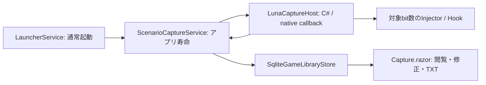

# シナリオ抽出

Windowsのゲーム本文をHOOKで取得し、キャラ名とセリフを組にして保存し、外部分析用のTXTへ出力する。翻訳・アプリ内分析は行わない。取得・分類・話者照合はベストエフォートであり、全作品対応や完全取得を保証しない。

## 利用範囲

- ゲーム編集の「シナリオ抽出」は初期値ON。変更は次回起動から反映する。OFFでは注入・本体選択・新規取得・取得画面への自動切替をしない。既存の起動前セーブリンク準備・Git同期と保存済み履歴は維持する。
- 登録EXEを通常どおり起動する。起動用と本体が異なる場合を含め、初回は実行中の本体を選ぶ。次回は記憶した実行ファイルの絶対パスと一意に一致するプロセスだけへ接続する。未一致・複数一致は手動選択する。PIDは次回用設定にしない。
- 自動検出されたHOOK候補の実出力を見て、「名前」「セリフ」「地の文」「本文（自動判定）」「取得しない」をゲーム別に設定する。本文の固定分類はセリフ・地の文で、未判別は未判定。名前は話者情報であり独立した本文分類ではない。コード・名称・context下位16bitを次回照合に使う。未一致・現在判明している複数候補との曖昧一致は自動選択せず、その回の候補を選び直す。
- 同時取得は1ゲーム・選択した本体1プロセス。OCR、任意HOOKコード、詳細codec/flush設定UI、自動再接続、本体交代追従は扱わない。内部codec・エンジン検出群はLunaHookを利用する。

## 構成



LunaのPythonアプリ・UI・翻訳DBは組み込まない。上流ソースは`library/LunaTranslator`の固定commitをsubmodule参照し、既存CMakeでHost・Hook・font loaderを構築する。GameLauncher側の小さなInjectorは上流`dllinject.cpp`をコンパイルし、翻訳・音声を含むLunaSubprocess全体は同梱しない。取得ページは受信処理の所有者ではない。

## 接続と受信確認

抽出設定は利用可能な画面に合わせた広い枠を使い、「接続」「取得元」「判定」を切り替える。ヘッダー・下端の確定/適用操作は本文のスクロール外に置き、候補の出現や設定切替で枠・操作位置を変えない。

接続画面の「画面から選択」は3秒後に前面にあるウィンドウの所有プロセスを選ぶ。利用者がゲームを前面にし、戻って対象を確認する。ランチャー自身は対象にせず、カウントダウンの中止・再試行を可能にする。実行中プロセスのメインウィンドウ一覧から選ぶか全プロセスへ切り替え、ウィンドウ名・プロセス名・PID・実行ファイルパスでも部分一致検索できる。画面選択は候補の指定だけで、テスト接続・注入は別の明示操作とし、ゲームの前面化やクリックを自動実行しない。

手動選択はテスト接続から開始する。ゲームを進めて受信した候補の文章を見て用途を指定し、「確定して記録」で本体パスと候補設定を保存する。テスト受信は比較と判定プレビューにだけ使い、履歴・原文・TXTへ保存せず、確定時の遡及取り込みも行わない。確定・切替・終了でテスト本文を破棄し、取得回と正式な受信連番は確定時から開始する。本文用途がない状態では確定しない。記憶済み本体が一意に見つかり本文設定もある場合は、次回起動時の自動接続から通常記録を開始する。

取得元は最大256候補、各候補の直近5受信をメモリ内に保持し、各受信は先頭1500文字まで表示する。比較一覧には直近3受信を示し、出現順を保って更新候補を強調する。文章の部分一致検索は保持中の5受信を対象とし、同じ文字列でも異なる取得元を統合しない。表示の一時停止中も受信は続け、再開時に最新へ戻る。用途の変更や詳細表示で他の操作を押し動かさない。名前の取得元を指定すれば、その受信内容を話者候補として使い、キャラクター名の事前登録は不要とする。

「判定」は保持中のテスト受信へ現在の分割・用途ルールを適用し、本文・分類・話者の仕上がりを表示する。正式保存と同じ分割・話者照合処理と元の受信時刻を使い、話者の2秒待ち・曖昧時の未確定も共通とする。ルール変更はテストの仕上がりへ反映し、確定前はDBへ保存しない。保持範囲外の受信は対象外で、1500文字を超えて省略した受信も判定プレビューから除き、画面に明示する。正式保存時の原文はこの表示上限で切り詰めない。

プロセスは接続後も選び直せる。記録中の切替は受付済み本文を処理して取得回を終了し、新しい対象をテスト状態にする。既存の本文・区間・確定済み設定を消さず、新しい紐付けは確定まで保存しない。接続失敗・本体終了・切断後も手動で再試行できる。自動再接続は行わない。取得元の選択は未接続・受信待ちを区別し、候補がある時だけ有効にする。

## 受信と寿命

`ScenarioCaptureService`をsingletonとし、delegate・ホスト・本体handle・取得回・受信順・候補保持・保存待ち・指定中の区間開始位置を所有する。一覧への移動、通常の×によるトレイ常駐、ページ破棄で取得を止めない。

callback内で文字列と取得元をmanaged値へコピーし、取得回内の連番・受信時刻を付ける。DB・UIをcallback内で待たない。候補変更と受信は同じlockで順序付け、保存待ちにはその受信時点のルールを渡す。本文をログへ複製しない。

正式記録中の未選択を含む一時保持は直近30秒・1候補200受信・全体1000受信・UTF-16本文合計2 MiBが上限。超過分は古い順に破棄する。候補表示は最大256候補、各プレビューは1500文字まで。プレビューを保存原文としない。記録開始後の候補変更では残る未処理イベントだけを元の連番で保存へ渡す。テスト受信はこの保存用bufferへ入れない。解除で過去履歴は消さず、再選択で同じイベントを再保存しない。

保存待ちも1000受信・2 MiBを上限とし、超過・単独巨大受信・書込み失敗は未保存としてログに残して諦める。失敗分の再投入・再試行・永続queue・退避ファイル・クラッシュ復旧は行わない。`(SessionId, ReceiveSequence)`で同じイベントだけを二重保存から守り、同文の別callbackを削除しない。ホスト前段の変換・buffering・エンジンfilterにより、ゲーム内の全出現・反復が届く保証はない。

本体終了・切断では新規受付を閉じ、通常の受付済み処理を終えて取得回の終了時刻を記録する。トレイの明示終了では最大3秒待って抽出を停止し、ゲームは終了しない。末尾の完全回収や終了時の救済確認は行わない。異常終了による終了時刻NULLは補完せず、自動再開もしない。注入・接続失敗は明示して手動選択へ戻し、起動済みゲームの成功を失敗へ変えない。

## ゲーム単位の本文と任意区間

閲覧・出力の主単位はゲームの履歴所有者（`CaptureGames`）。複数起動の本文を取得回ID、回内受信連番、原文内開始位置の順に読む。受信時刻の変更で順序を入れ替えない。取得回はソース識別・連番リセット・話者照合の内部境界として残し、既存の原文と手動修正を移し替えたり複製したりしない。

必要な時だけ自由な名前の区間を保存する。区間は同じゲームの原文位置を示す開始と終了を持ち、開始を含み終了を含まない。区間0件、範囲外の本文、重なり、同名を許可する。全本文の割当や次区間からの自動終点は設けない。名前はtrim後の空欄・改行を拒否するが、章番号などの形式や一意性は要求しない。

境界は`SessionId / ReceiveSequence / UTF-16 offset`で保存する。原文の有効なtext element境界を検証し、開始より後の終了と1件以上の本文が必要。同じ原文の再分割でitem IDが変わっても区間を保持し、現在のitemを境界で切り取って表示・出力する。別ゲームや未保存の本文は参照させない。

- **本文で指定**：本文行の「ここから」「ここまで」で先頭行の開始・末尾行の終了を選ぶ。ページをまたいで指定でき、同じ行だけの区間も作れる。名前入力後に保存する。
- **プレイ中に指定**：「ここから開始」は直前に保存queueへ受理した本文の末尾を記録する。未受信ならその取得回の先頭を使う。「ここまでで終了」でその時点の末尾を固定し、名前を入力して保存する。終了後の受信は含めない。保存前にwriterをflushし、保存済み原文を検証する。空区間や保存失敗を保存成功へ置き換えない。

開始・終了は抽出ON/OFFではない。取消や区間外でも本文は保存する。開始位置はページ移動やトレイ常駐で保持するが、ゲーム終了・切断・アプリ終了では未完了区間を保存せず、自動確定・再起動復元もしない。native bufferingにより押下とゲーム画面の境界は完全一致を保証せず、受理済みログ基準とする。自動場面判定・ゲームのセーブ/復元は提供しない。保存履歴の「履歴管理」で区間を改名できる。区間削除は名前と範囲の定義だけを削除し、本文を保持する。

## 区間タグと出力条件

区間名と別に、自由な名前のタグを任意で複数付けられる。区間作成時と履歴管理で追加・解除でき、区間名とタグは同じtransactionで保存する。タグ名はtrim後の非空・改行なしの単一行とし、表記を自動統合せず完全一致で区別する。同じ区間の同じタグは一つだけ保持する。既存区間はタグなしで利用できる。

同じゲームの区間に付いているタグを候補として再利用する。区間とタグの関係を正本とし、独立したタグマスタや未使用タグの管理は設けない。人物名は本文の名前検索で扱え、タグへの二重登録・自動付与は必要としない。タグは本文の分類・話者・原文を変更しない。

TXT・画像付きZIPの出力操作では、現在のゲーム・区間・分類・適用済みの名前/本文検索に加え、包含タグと除外タグを選ぶ。各欄の複数タグはいずれかに一致する区間を対象とする。包含タグ指定時はその区間の和集合だけを出し、未指定時はゲーム全体または選択中の区間を対象とする。その後、除外タグの区間の和集合を差し引く。重なる部分は除外を優先し、包含区間同士の重複で本文を二重出力しない。タグ未指定は従来の条件と同じで、条件に一致する本文がない出力も許可する。

区間の原文位置で本文を切り取り、除外で分かれる場合は残った複数範囲を受信順・原文内位置順に出す。本文検索は切取後の各範囲へ適用し、除外文字列だけに一致する範囲を出さない。TXTとZIPは同じ出力読出しを使い、表示ページの件数上限には限定しない。ZIPには残った本文の原文に関連する画像だけを含める。画像は原文単位の関連なので、同じ原文の一部を除いた場合も画像自体は切り取らない。

## 原文と分類

原文は選択済み候補から届いたcallback文字列であり、不変。本文は同じ原文内の`StartUtf16 / LengthUtf16`範囲で表し、先頭から末尾まで空白・改行・括弧を含めて欠けなく覆う。別callbackを自動結合しない。

ゲーム別ルールで、対応する外側の`「…」`をセリフに分け、その外を地の文または未判定にする。内側の引用は残す。閉じていない括弧は未判定、`『…』`単独はセリフと決め付けない。分割OFFは全文1範囲の未判定。候補に既定ラベルを指定した場合は分割後の各範囲へ優先適用する。

新規の分類指定はセリフ・地の文の固定選択で、未判定はラベル参照NULLとする。自由追加と名称変更のUI・書込みAPIは提供しない。名前は本文の話者であり、話者NULLの未確定は分類未判定とは別の状態。分類はゲーム別のIDで参照し、保存済みの独自名・用途種別・参照は保持して閲覧・TXTへ出力する。固定分類による絞り込みは同じ用途種別の保存済みデータも含める。

話者文字列は本文itemと組にして保持し、地の文の有効話者はなしとする。人物マスタは作らない。自動照合は同じ回・対象プロセスの選択済み名前受信と本文だけを使う。

- 受信時刻の前後1秒以内で、単独名1件とセリフ1件が互いに一意の場合だけ照合する。本文から2秒待ち、名前の将来側の窓も閉じてから自動値を更新する。本文は先に未確定で保存する。
- 名前用途の受信をtrimし、空でなく改行（CR/LF）を含まない単一行を話者候補にする。登録済みの名前との照合は行わない。区切りのない単一行へ連結された複数名は識別・分解できず、受信した文字列全体が候補となる。
- 窓内の複数名・複数セリフ・同一原文内の複数セリフは順番に配らず未確定にする。直前名を次の全発言へ持ち越さない。名前の先着・後着とも元の受信時刻で照合し、本文順を動かさない。
- 名前用原文は照合用に保存するが、通常本文/TXTへ独立行として出さない。誤照合・未確定は本文itemの話者を手動修正できる。

通常照合は最大1000件の判定待ち集合だけへ一度行い、保存した受信時の用途を使う。上限超過・照合失敗は原文の保存と区別してログへ残し、話者未確定を許容する。終了時に窓が閉じていない分も完全回収しない。最新ルールで既受信分を周期的に再分類しない。設定に保存済みの名前一覧はデータとして保持するが、話者判定には使わない。

## 修正と再適用

手動ラベル・話者は値と上書きフラグを分ける。手動NULLは意図した未判定・未確定であり、自動値で埋めない。表示・TXTは手動値を優先する。有効ラベルが地の文なら話者を表示しないが、保存済み手動値自体は削除しない。

ルール保存は以降の受信へ適用する。過去分は利用者が選択したitem ID集合へ明示再適用し、新着を対象へ増やさない。選択範囲の自動ラベル・話者だけを更新する。原文全範囲が選択され、手動修正がない時だけ再分割できる。手動境界・ラベル・話者を含む原文は既存分割を保ち、その範囲内の自動値だけを再判定する。

「原文・分割」では1原文内の境界追加・隣接境界解除を行い、置換後の各範囲のラベル・話者を指定して一つのtransactionで保存する。原文文字列は変更しない。UTF-16位置を使い、サロゲート・結合文字等のtext element途中を手動境界にしない。利用者自身による再修正は可能。別原文をまたぐ結合・全版履歴・人物付替え機能は設けない。

## 保存と登録削除

既存`game-library.db`のschema初期化へ以下を追加する。既存テーブル・適用済み移行・ゲーム/セーブリンク/同期履歴を再作成しない。通常の主キーとFKを使い、独自の整合性台帳は作らない。

| テーブル | 責務 |
| --- | --- |
| CaptureGames | 登録から独立した履歴所有者、表示タイトル、次回ON/OFF、本体絶対パス、候補・分類ルールJSON |
| CaptureSessions | 所有者と取得回の開始/終了時刻 |
| CaptureSources | 取得回内の取得元、PID・HOOKコード/名・64bit値の16進文字列 |
| CaptureEvents | 取得回と受信連番の複合主キー、取得元・時刻・入力役割・原文・手動境界フラグ |
| CaptureLabels | 所有者別の名称と用途種別 |
| CaptureItems | 原文内UTF-16範囲、自動ラベル/話者、手動上書きフラグと値 |
| CaptureRanges | 所有者別の自由名と原文上の開始/終了位置 |
| CaptureRangeTags | 区間に付けた自由タグ。区間削除とともに関係を削除 |

原文追加と本文範囲作成は同じtransactionでcommitし、それ以前を保存済みとしない。同一取得回の取得元・原文・itemは複合FKで結び、書込み境界で同一所有者のラベルと範囲を検証する。

全接続でSQLite FKを有効にする。`CaptureGames.CurrentGameId`は`Games.Id`へのnullable unique FKで`ON DELETE SET NULL`。登録削除では所有者・履歴を残し、表示タイトルで閲覧・出力できる。登録中のタイトル変更は履歴所有者へ反映する。同じslug・タイトル・EXEで再登録しても、新規所有者を作り旧履歴と統合しない。手動付替え・ラベル削除/統合は提供しない。

履歴削除はゲーム登録削除と独立した明示操作とする。保存履歴の本文を選び、削除対象の原文と件数を確認して確定する。削除単位は元の本文受信イベントで、同じ原文から分割された全itemを含む。検索・分類条件から外れた同一原文の本文も確認対象に含め、原文とitemを同じtransactionで削除する。itemだけを非表示にして再適用・再分割で復活させる方式は使わない。別の名前受信や他の本文は残す。区間の原文位置・取得回は維持し、区間内の削除済み本文は表示・TXTから除かれる。削除後に空になった区間も保持する。

「全履歴を消去」は選択ゲームの全取得回・取得元・受信原文（名前を含む）・本文・区間を一つのtransactionで削除する。検索や表示区間には限定しない。履歴所有者、抽出ON/OFF、本体パス、取得元の用途・分類ルール、分類定義、ゲーム登録、セーブデータ、他のゲームの履歴は維持する。対象ゲームの取得中は削除を確定できず、先に「取得を停止」で保存待ちを処理して終了する。ゲームのプロセスは終了しない。操作後も保存済み設定でテスト接続・記録を再開できる。自動削除やundoは提供せず、確認画面で戻せないことを示す。

抽出履歴専用の自動バックアップ・Git同期は追加しない。既存の同期対象へDBを勝手に追加しない。

## UIとTXT

Homeの本のアイコンから`/capture`を開く。ON起動後も同じ画面へ移る。ゲーム編集のON/OFFは同じ画面の保存で確定し、キャンセルでは反映しない。本文・話者を主領域とし、操作はアイコンを基本にする。常設の案内文・重複した状態説明は置かず、本文・名前・入力項目・必要な状態とエラーを表示する。アイコンにはtitleとaccessible nameを持たせ、選択状態はaria-pressedで示す。接続・取得元の比較・判定プレビューは抽出設定の各タブで扱い、保存履歴では自動判定ルールだけを編集する。診断のコードやcontextは取得元の詳細を開いて確認する。今回の受信・commit済み件数・未保存/破棄件数は別のアイコンと数値で示す。未保存/破棄には未選択候補の保持期限切れ等を含み、titleとaccessible nameでも区別する。

取得中のゲーム全体表示は末尾追従時だけ新着を表示し、描画後に末尾へ移動する。過去へのスクロール・本文での区間指定・修正で追従を止め、明示操作で戻す。選択中は追従を再開せず、解除後に戻す。履歴はゲーム（登録なしを含む）・区間（ゲーム全体を含む）・分類（未判定を含む）で絞り、200件単位で読む。区間の表示中は修正・選択削除を無効にし、「ゲーム全体」へ戻して元itemを選ぶ。切り取った表示外を無言で変更しない。同名区間は表示上の件目で区別する。

履歴検索は名前と本文を別々に入力し、区間・分類を含むすべての条件を満たす本文を返す（AND）。名前は表示上の有効話者、本文は区間で切り取った表示本文を対象に、OrdinalIgnoreCaseの部分一致でページング前に絞る。名前だけ・本文だけでも検索でき、空欄・空白だけの欄は条件にしない。検索文字はtrimし、`%`・`_`等もワイルドカードではなく文字として扱う。検索ボタンまたはEnterで名前・本文を適用し、区間・分類の変更とページ送りでも適用済み検索を保持する。検索解除は名前・本文だけを空にし、ゲーム変更時は全条件を解除する。履歴のDB読込・照合と全件出力用の検索はUI threadを塞がないように実行し、読込中を表示して重複操作を抑止する。

プレイ中の開始・終了・取消をゲーム状態と同じ領域に常設し、本文をスクロールしても同じ位置・大きさで操作できる。本文での区間指定は各行の修正用slotを切り替え、状態・両端の要約は予約領域へ表示する。本文の区間指定、一括修正、追従・ページ切替、設定・出力は一つの操作列へまとめる。ページ切替は本文領域の先頭から表示する。明示した一括操作は表示選択集合だけを取得回ごとに修正する。選択数と操作領域の大きさは変えず、一括修正・設定・区間名入力はoverlay、成功・エラーは固定位置の通知で示し、本文を押し動かさない。ダイアログはkeyboard focusを閉じ込め、Escapeで閉じ、操作元へ戻す。

TXT出力は表示ページの200件制限ではなく、選択したゲーム全体または区間の分類・検索条件に合う全itemを対象とする。UTF-8（BOMなし）、取得回・受信連番・原文内開始位置順、項目間は空行。現在のラベル名と有効話者を使う。

```text
[セリフ：美咲]
「おはよう」

[地の文]
窓から光が差した。

[セリフ：話者未確定]
「また明日」

[未判定]
まだ分類していない文章。
```

本文中の括弧・改行を残し、時刻・PID・HOOK診断情報は通常TXTへ載せない。出力は原文や分類を変更せず、同文を重複排除しない。指定フォルダへ新規ファイルを作り、既存ファイルを上書きしない。出力失敗は成功通知にしない。

## 手動スクリーンショットと分析用ZIP

正式記録中はアプリ寿命の`ScenarioScreenshotService`がグローバルキーを登録する。初期値はAlt+Shift+Sで、撮影設定からCtrl/Alt/Shiftと英数字・F1〜F11の組合せを保存できる。ゲームのスキップ操作などと重ならない組合せを使う。ページ移動やトレイ常駐では解除せず、取得終了・切断・アプリ終了で解除する。競合などの登録失敗、撮影中の再入力、対象消失、画像・本文保存失敗は撮影状態に表示する。キーリピートによる連写と待ち行列は設けず、同時処理は1件とする。

キー置換は新登録・設定保存の成功時だけ有効設定を更新する。失敗時は以前の有効な登録へ復旧し、復旧失敗は未登録として再設定を案内する。設定ファイルは同じディレクトリの一時ファイルへ書いてから置換し、書込失敗で以前のファイルを壊さない。失敗と処理中の拒否は既存Windows通知と短音で伝え、同serviceの通知を5秒間抑制する。音や通知の表示はWindowsの設定にも依存する。アプリ起動中の直近失敗は停止の状態更新とは別に保持し、撮影設定から時刻・理由・再設定方法を確認できる。新しい永続通知履歴は設けない。

通常終了は新規撮影を止めて受付済みTaskを待つ。10秒の猶予後は協調中止を要求し、PNG取得・本文flush待ち・画像保存gate/一時書込で中止を受け付ける。DB commit前の中止では関連と作成途中の画像を残さず、commit確定後は保存済みとして返す。終了Taskだけを時間切れにして撮影処理を切り離さない。commit等の確定境界を待つため、厳密に10秒以内にアプリが閉じるという保証ではない。

撮影は最前面ゲームのクライアント領域だけを`GetClientRect`・`ClientToScreen`・desktop DCの`BitBlt`で取得する。タイトルバー・枠は含めず、ゲームへキーを送ったり、撮影後にアプリやプレビューを前面化したりしない。本文取得PIDに対象窓が1件なら自動選択する。複数・不在の場合は明示選択が必要で、無関係な前面窓への代替はしない。撮影窓だけ別プロセスへ変更できるが、本文の取得先や履歴所有者は変更しない。HWND/PIDは現在の取得回だけの値とし、終了や再接続で破棄する。窓の消失・PID不一致・最前面でない場合は撮影しない。

キー受付時、正式記録で最後に保存queueへ受理した非空Bodyの`CaptureGameId / SessionId / ReceiveSequence`を同一lockで固定する。名前受信は対象を進めず、テスト受信・本文未受信・終了処理中は拒否する。撮影・PNG変換・hash計算は本文writerから分離し、受付済み本文をflushした後に原文の存在・所有者を確認して関連を保存する。処理中の新本文・取得回変更で固定した対象を置換しない。保存に失敗した原文へリンクしない。画像は近傍シーンの目印であり、ゲーム表示との厳密な同期や±1行以内の保証はしない。

画像はDBと同じデータrootの`scenario-images`へPNGで保存する。画素は上から下・左から右のpaddingなしRGBA8、alpha=255に正規化し、32bit little-endianの幅・高さを先頭に付けたSHA256を`sha256-dimensions-rgba8-v1`として使う。圧縮済みPNGではなく寸法を含む画素の完全一致だけを共有し、縮小・非可逆圧縮・近似一致は使わない。

`CaptureImages`に画像ID・寸法・pixel hash、`CaptureEventImages`に原文の複合キー・画像ID・撮影時刻を保存する。原文と画像は多対多。同じ原文への同じ画像は追加せず最初の撮影時刻を維持する。関連は再分割で変わるitem IDではなく原文キーに結ぶ。ゲーム登録削除では保持する。原文削除・全履歴消去では本文と関連のDB削除を確定した後、未参照PNGを削除し成功時だけ画像metadataを除く。後片付け失敗でも本文の削除は完了として一覧を更新し、未回収件数・理由・明示再試行を案内する。未参照の`CaptureImages`から対象を導出し、別tableや起動時の自動GCは設けない。未回収PNGは同hashの再撮影で再利用でき、参照された後は回収対象にしない。画像をセーブデータのGit同期へ追加しない。

履歴の本文行からその原文に紐づく画像を開く。表示ページの原文key集合の添付件数を1SQLで取得し、画像ボタンに枚数を示す。0枚と取得失敗を区別し、件数表示のために画像本体を読まない。再分割された同じ原文の行にも同じ添付件数を示す。ZIP出力はTXTと同じ適用済みゲーム・区間・分類・名前・本文AND条件の全件を対象とし、表示ページ上限を適用しない。本文・分類・話者・区間・画像関連を同一DB snapshotで確定し、出力中は対象画像の削除と競合させない。ZIPは新規ファイルへ完成してから公開し、既存出力を上書きしない。欠落画像やコピー失敗を成功扱いしない。

- `manifest.json`: format=`GameLauncherWithGit.scenario`、schemaVersion=1、出力時刻、ゲーム、条件snapshot、UTF-16 code unit指定、hash方式、画像IDと相対path・寸法・hash。
- `texts.jsonl`: 原文イベントごと1行。取得回・受信連番・原文内開始位置順で、選択された現在のsegmentの開始・長さ・本文・有効分類/ラベル/話者と、画像ID・撮影時刻を記載する。除外部分を含む`rawText`は出力しない。同文別イベントを統合しない。
- `images/<id>.png`: 選択本文が参照する画像だけを重複なく収録する。IDは出力内識別子、pathは相対pathとし、端末上の絶対pathは載せない。部分区間でも画像の関連範囲は`capture_event`、方法は`latest_received_body`と明示し、後続本文へ暗黙に持ち越さない。

## ネイティブbuild・安全境界

build手順は[README](../../README.md#windows-での-ui-確認)、依存版と配布条件は[Third-party notices](../../THIRD-PARTY-NOTICES.md)を参照する。Hostはランチャー、Injector/Hookは対象のbit数に合わせる。callbackはcdecl、`ThreadParam`はDWORDと3つのuint64値、boolは1byte。文字列はcallback中にコピーする。Hostはbackground threadを持つためアプリ寿命中にDLLをunloadしない。

接続用pipe、注入要否確認、helper実行、接続callbackを分ける。helper終了だけでは成功としない。接続待ちは15秒で打ち切り、自動再試行・自動昇格は行わない。

上流の32bit注入には、対象に`GuruGuruSMF4.dll`がloadされるか実行フォルダに存在する狭い条件で、そのプロセス内の`WinVerifyTrust`を書き換える処理がある。対象内の他の署名検証にも影響し得るため、信頼できるゲームだけに利用する。この条件を広げず、OS全体の保護解除は行わない。

## 検証境界

自動testは原文・順序・同文別受信、分類/話者、手動値と範囲、登録削除/再登録、OFFと候補保持を一時DBで確認する。UIは実データを持たない隔離環境で実描画と操作を確認する。実ユーザープロファイルのアプリ起動は登録repositoryの監視・同期を伴うため、検証目的で安易に起動しない。

synthetic processでのC#接続確認と、実ゲーム本文の画面照合・全作品対応は異なる。実ゲームの精度、長時間負荷、MSIX配布の成立はそれぞれ対象環境と条件を定めて確認し、build成功だけで確認済みとしない。
